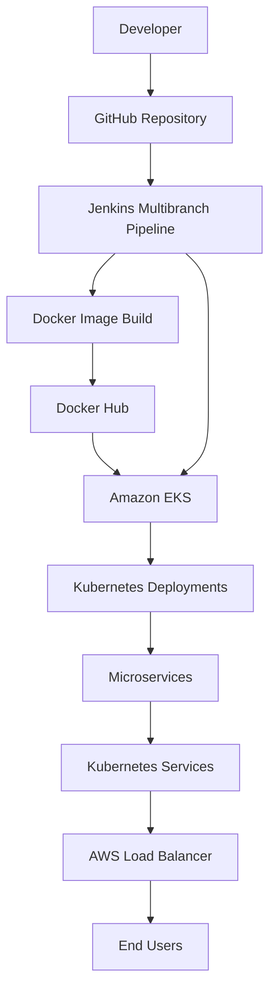
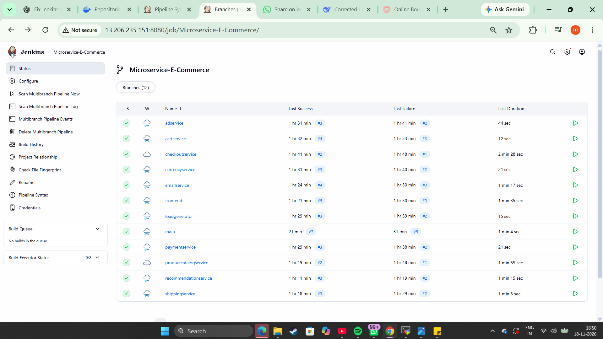
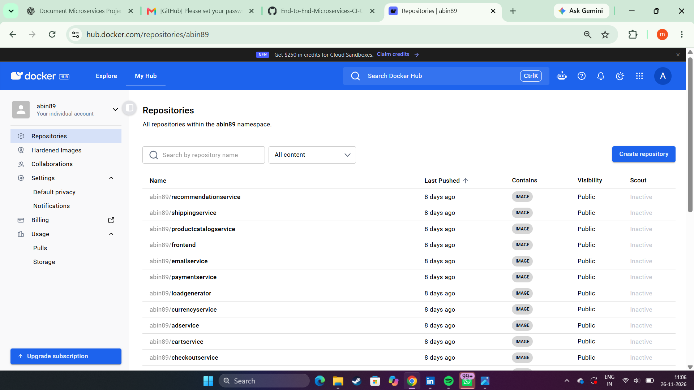
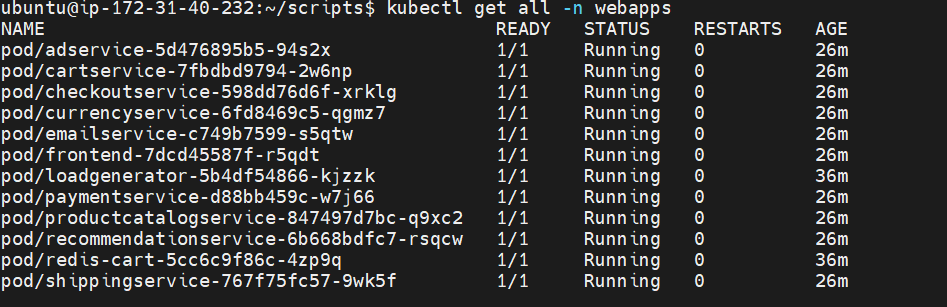
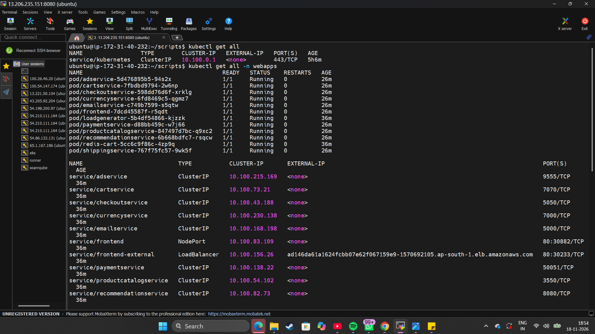

# End-to-End Microservices CI/CD on AWS EKS

## Project Overview

This project demonstrates an end-to-end DevOps implementation for a cloud-native, microservices-based e-commerce application deployed on Amazon Elastic Kubernetes Service (EKS).

The project implements CI/CD automation using Jenkins Multibranch Pipeline, Docker for containerization, Docker Hub for container image management, and Kubernetes for container orchestration.

The primary objective is to demonstrate automated application delivery, independent microservice builds, cloud infrastructure integration, and real-world DevOps troubleshooting.

---

## Technology Stack

| Technology | Purpose |
|------------|---------|
| AWS EKS | Managed Kubernetes cluster |
| Jenkins | CI/CD automation |
| Jenkins Multibranch Pipeline | Branch-specific pipeline execution |
| Git & GitHub | Source code management |
| Docker | Application containerization |
| Docker Hub | Container image registry |
| Kubernetes | Container orchestration |
| AWS ELB | External application access |
| Redis | Shopping cart data storage |
| Linux | Administration and troubleshooting |

---

## Project Architecture



---

## Key Features

- End-to-end CI/CD automation
- Jenkins Multibranch Pipeline implementation
- Independent microservice build pipelines
- Docker-based application containerization
- Centralized container image management using Docker Hub
- Microservices deployment on Amazon EKS
- Kubernetes-based service discovery
- External application access through AWS Load Balancer
- Kubernetes workload management and self-healing
- Real-world CI/CD and Kubernetes troubleshooting

---

## Microservices Architecture

The e-commerce application consists of multiple independently deployable microservices.

| Microservice | Description |
|--------------|-------------|
| Frontend | Provides the application user interface |
| Cart Service | Manages user shopping carts |
| Product Catalog Service | Provides product information |
| Checkout Service | Handles order processing |
| Payment Service | Simulates payment processing |
| Shipping Service | Handles shipping operations |
| Currency Service | Provides currency conversion |
| Email Service | Handles simulated order confirmation emails |
| Recommendation Service | Provides product recommendations |
| Ad Service | Displays advertisements |
| Load Generator | Simulates application traffic |
| Redis | Stores shopping cart data |

---

## CI/CD Pipeline Workflow

### 1. Source Code Management

- Application source code is maintained in GitHub.
- Separate branches are maintained for individual microservices.
- Jenkins Multibranch Pipeline discovers and manages branch-specific Jenkinsfiles.

### 2. Continuous Integration

- Jenkins checks out the source code.
- Individual microservice pipelines execute their build stages.
- Docker images are built for the respective microservices.

### 3. Container Image Management

- Docker images are tagged.
- Jenkins authenticates with Docker Hub using configured credentials.
- Container images are pushed to Docker Hub.

### 4. Continuous Deployment

- Jenkins connects to the Amazon EKS cluster using configured Kubernetes credentials.
- Kubernetes deployment and service manifests are applied.
- Microservices are deployed inside a dedicated Kubernetes namespace.

### 5. Deployment Verification

- Kubernetes pods, deployments, and services are verified.
- Application connectivity is tested.
- The frontend application is exposed through an AWS Load Balancer.

---

## Kubernetes Implementation

The application is deployed on Amazon EKS using the following Kubernetes resources:

- **Deployments:** Manage application replicas and container lifecycle.
- **Pods:** Run individual microservice containers.
- **ReplicaSets:** Maintain the desired number of pod replicas.
- **ClusterIP Services:** Enable internal microservice communication.
- **NodePort Service:** Provides node-level frontend access.
- **LoadBalancer Service:** Enables external application access.
- **Namespaces:** Provide logical isolation of application resources.

### Kubernetes Namespace

```bash
kubectl create namespace webapps
```

### Configure EKS Access

```bash
aws eks update-kubeconfig \
  --region ap-south-1 \
  --name EKS-1
```

### Verify Worker Nodes

```bash
kubectl get nodes
```

### Deploy Application

```bash
kubectl apply -f deployment-service.yml -n webapps
```

### Verify Deployment

```bash
kubectl get pods -n webapps

kubectl get deployments -n webapps

kubectl get svc -n webapps

kubectl get all -n webapps
```

### Retrieve Application Endpoint

```bash
kubectl get svc frontend-external -n webapps
```

The application can be accessed using the external AWS Load Balancer endpoint.

---

## Jenkins Multibranch Pipeline

Jenkins Multibranch Pipeline is used to manage CI/CD workflows across multiple microservice branches.

### Benefits

- Automatic branch discovery
- Independent microservice builds
- Branch-specific Jenkinsfile execution
- Improved pipeline maintainability
- Centralized CI/CD management
- Reduced manual deployment effort

The main branch contains the Kubernetes deployment workflow, while individual microservice branches manage their respective container build workflows.

---

## Project Screenshots

### successful Jenkins Multibranch Pipeline



### Docker Hub Images



### Kubernetes Pods



### Kubernetes Services



### E-Commerce Application


## Challenges and Troubleshooting

During the implementation, several real-world DevOps challenges were encountered and investigated.

| Challenge | Troubleshooting Approach |
|-----------|--------------------------|
| Docker API compatibility issue | Verified Docker client and server compatibility and corrected Jenkins Docker configuration |
| Docker Hub push access denied | Verified registry credentials and image repository permissions |
| Kubernetes namespace not found | Created and configured the required namespace |
| Kubernetes authentication failure | Configured Jenkins Kubernetes credentials and verified EKS connectivity |
| Frontend CrashLoopBackOff | Investigated container logs, pod events, and application configuration |
| Load Balancer connectivity issues | Inspected Kubernetes services, endpoints, and application connectivity |

### Troubleshooting Commands

```bash
kubectl describe pod <pod-name> -n webapps

kubectl logs <pod-name> -n webapps

kubectl logs <pod-name> -n webapps --previous

kubectl get events -n webapps

kubectl get endpointslice -n webapps

kubectl describe svc frontend-external -n webapps
```

These troubleshooting activities provided practical experience in identifying and resolving CI/CD, containerization, authentication, deployment, and networking issues.

---

## Security Practices

- Managed Docker Hub authentication using Jenkins Credentials.
- Used configured Kubernetes credentials for cluster access.
- Isolated application workloads using a dedicated namespace.
- Used internal Kubernetes services for backend microservice communication.
- Exposed the frontend through a dedicated external service.

---

## Key Learnings

Through this project, I gained hands-on experience in:

- Designing end-to-end DevOps workflows.
- Implementing Jenkins Multibranch Pipelines.
- Managing multiple microservices independently.
- Building and managing Docker container images.
- Deploying cloud-native applications on Amazon EKS.
- Understanding Kubernetes networking and service discovery.
- Managing Kubernetes deployments and services.
- Troubleshooting CI/CD pipeline failures.
- Debugging Kubernetes container and networking issues.
- Integrating cloud infrastructure with CI/CD tools.

---

## Future Enhancements

- Infrastructure provisioning using Terraform
- GitOps-based deployment using Argo CD
- Container vulnerability scanning using Trivy
- Code quality analysis using SonarQube
- Monitoring using Prometheus and Grafana
- Horizontal Pod Autoscaling
- HTTPS and custom domain configuration
- Centralized logging and alerting

---

## Conclusion

This project demonstrates a practical approach to deploying and managing a cloud-native microservices application using modern DevOps tools and AWS infrastructure.

It highlights CI/CD automation, container orchestration, microservices management, cloud deployment, and real-world troubleshooting skills.

---

## Author

**Abin VA**

Aspiring DevOps & Cloud Engineer

- GitHub: [abin7890](https://github.com/abin7890)
- LinkedIn: [Abin VA](https://www.linkedin.com/in/abin-va-37b502354/)

---

If you find this project useful, consider giving this repository a star.
